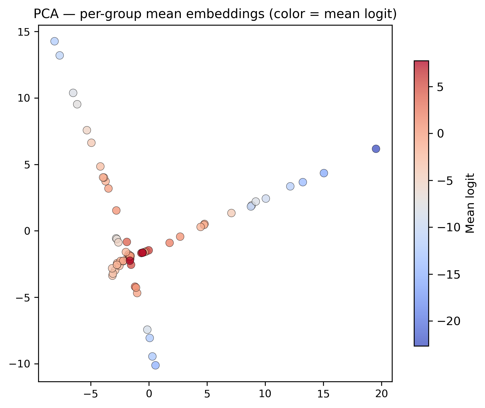

# Background-driven shortcut learning in gravitational lens classification

Analysis code demonstrating background-driven shortcut learning in CNN-based gravitational lens classifiers, including embedding-space diagnostics and Grad-CAM analyses.

<!-- Badges (update after release) -->
<!--  -->
<!--  -->


---

## 30-second reproduction

```bash
git clone https://github.com/blumhardt-m/lens-selection-shortcut-learning
cd lens-selection-shortcut-learning
conda env create -f environment.yml
conda activate lensml
python analysis/04_embedding_diagnostics.py
```

This reproduces the key embedding-space separation figure:



*PCA of per-group mean embeddings (128-dim penultimate layer) for 32 catastrophic
(FPR=1.0) and 32 clean (FPR=0.0) background groups. Color encodes the mean
positive-class logit. Catastrophic groups are linearly separable in embedding
space (LOO AUC = 0.95, permutation p < 0.005) despite being indistinguishable
by classical morphology descriptors.*

---

## Overview

A CNN-based gravitational lens classifier trained on 101x101 pixel galaxy
cutouts exhibits a systematic failure mode: **false positives are concentrated
in a small subset of background galaxies**. This repository provides the
analysis code demonstrating that:

1. **FP concentration is extreme**: the top 10% of background groups produce
   ~80% of all false positives (Gini = 0.88, p < 5x10^-4 against uniform null).

2. **Classical morphology fails to explain it**: standard descriptors
   (concentration, peak radius, central flux) show no significant separation
   between catastrophic and clean groups (KS/AD p > 0.25).

3. **The shortcut is encoded in learned representations**: catastrophic groups
   are linearly separable in the CNN's 128-dim penultimate embedding
   (LOO AUC = 0.95), proving the model has learned a discriminative background
   representation not captured by human-interpretable features.

4. **Grad-CAM confirms diffuse background attention**: attribution maps for
   catastrophic groups show significantly higher off-center activation
   (p = 5x10^-13), consistent with background-driven shortcut learning.

## Repository structure

```
analysis/              Analysis scripts (numbered, self-contained)
  01_fp_concentration.py    Gini coefficient, Lorenz curve, permutation null
  02_gradcam_examples.py    Qualitative Grad-CAM figure
  03_gradcam_quantitative.py  Attribution metrics + Mann-Whitney tests
  04_embedding_diagnostics.py  Embedding-space separation analysis

src/                   Reusable modules
  model.py             ProtocolCNN architecture (360,033 params, fixed)
  dataset.py           Dataset loading and normalization
  inference.py         Batch and single-image inference
  embedding.py         Embedding extraction and Grad-CAM
  metrics.py           Gini, Lorenz, attribution metrics

demo/                  Minimal inference demo
  demo_inference.py    Run classifier on a single FITS cutout
  example_cutout.fits  Synthetic 101x101 demo image

figures/               Key figures for the paper
models/                Checkpoint directory (see models/README.md)
data/                  Data directory (see data/README.md)
scripts/               Shell scripts for figure generation
```

## Reproducing the analysis

| Script | Requires | Produces |
|--------|----------|----------|
| `01_fp_concentration.py` | `test_predictions.npz` (5 folds) | Gini stats, Lorenz curve, permutation null |
| `02_gradcam_examples.py` | Checkpoints + dataset | Qualitative Grad-CAM 6-panel figure |
| `03_gradcam_quantitative.py` | Checkpoints + dataset | Attribution boxplots, Mann-Whitney tests |
| `04_embedding_diagnostics.py` | Checkpoints + dataset + predictions | PCA/t-SNE figures, separation metrics |

To regenerate all figures (requires data + checkpoints):

```bash
bash scripts/make_submission_figures.sh
```

Scripts fail gracefully with clear messages when required data or checkpoints
are not available.

## Run the model on a single galaxy cutout

```bash
python demo/demo_inference.py
```

Runs the ProtocolCNN on the included synthetic example FITS cutout and prints
a lens probability. Supply your own image and checkpoint:

```bash
python demo/demo_inference.py --fits your_cutout.fits --checkpoint your_model.pt
```

See `demo/README.md` for details.

## Environment setup

```bash
conda env create -f environment.yml
conda activate lensml
```

Or via pip:

```bash
pip install -r requirements.txt
```

## Data availability

The full survey dataset and locked fold checkpoints are not included in
this repository due to size constraints. See `data/README.md` and
`models/README.md` for expected file locations and formats. A small
synthetic demo cutout is included at `demo/example_cutout.fits`.

## Citation

If you use this code, please cite:

```bibtex
@software{blumhardt2026shortcut,
  author = {Blumhardt, Michael},
  title = {Background-driven shortcut learning in gravitational lens classification},
  url = {https://github.com/blumhardt-m/lens-selection-shortcut-learning},
  version = {1.0.0}
}
```

See `CITATION.cff` for machine-readable citation metadata.

## Reproducibility

This repository contains analysis code for the locked evaluation pipeline.
Large raw data and model checkpoints are excluded from version control.
All analysis scripts document their input requirements and fail gracefully
when prerequisites are missing.

Key results from the locked pipeline:

| Metric | Value |
|--------|-------|
| FP Gini coefficient | 0.88 |
| Catastrophic groups (FPR=1.0) | 32 of 217 |
| Embedding LOO AUC | 0.95 |
| Grad-CAM peak outer (catastrophic vs clean) | p = 5x10^-13 |

## Journal submission checklist

- [x] Environment file (`environment.yml`, `requirements.txt`)
- [x] Analysis scripts (numbered, self-contained)
- [x] Key figures committed
- [x] Citation metadata (`CITATION.cff`)
- [ ] Zenodo DOI (to be added after GitHub release)
- [ ] Versioned release (`v1.0.0`)

## Author

Michael Blumhardt
Independent Researcher

## License

[MIT](LICENSE)
