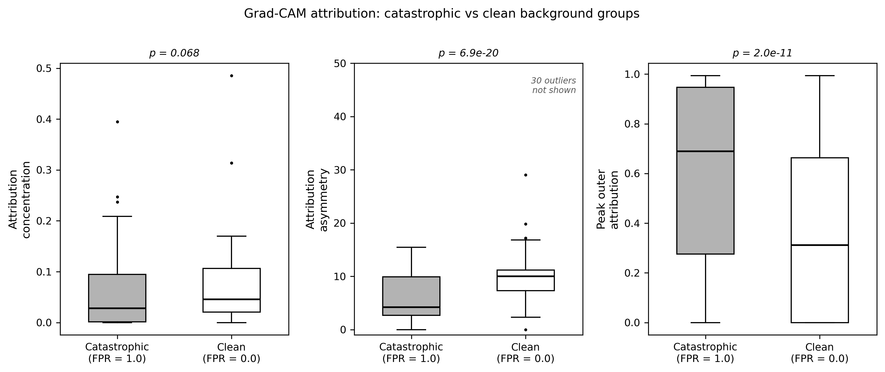

# Background-Disjoint Cross-Validation for Gravitational Lens Classifiers

## Paper

**Background-Disjoint Cross-Validation Reveals Hidden Failure Modes in CNN Gravitational Lens Classifiers**
Michael Blumhardt (2026)

LaTeX source: [`paper/lens_paper_v2.tex`](paper/lens_paper_v2.tex) · Figures: [`paper/figures/`](paper/figures/)
No compiled PDF is included in this repository. The paper is submitted for journal review; a preprint link will be added here upon posting.

---

Standard image-level cross-validation can leak background morphology into evaluation when injection pipelines generate multiple training samples from the same galaxy: images sharing a background can appear in both training and test folds, allowing a model to memorise background structure and return optimistic performance estimates. **Background-disjoint cross-validation (BDCV)** prevents this by assigning all images derived from a given background galaxy to the same fold, eliminating the leakage pathway entirely.

---

## Main result

| Evaluation protocol | AUC | TPR | FPR |
|---------------------|-----|-----|-----|
| Standard 5-fold KFold | 0.968 | 0.935 | 0.106 |
| Background-disjoint KFold | 0.917 | 0.781 | 0.145 |

Same dataset, architecture, hyperparameters, and seed. Protocols differ only in fold construction.

**False-positive concentration:**

| Statistic | Value |
|-----------|-------|
| FP Gini coefficient | 0.879 |
| Permutation null maximum (2,000 replicates) | 0.530 |
| Gap above null maximum | 0.35 |
| Backgrounds with ≥1 FP | 32 of 217 |
| Catastrophic backgrounds (FPR = 1.0) | 29 of 217 |
| Backgrounds with zero FP | 185 of 217 |

The observed Gini coefficient lies 0.35 above the entire permutation null support, placing the concentration completely outside the range expected under background-independent error allocation.

---

## Quick reproduction

Reproduces the main false-positive concentration result: Gini coefficient, Lorenz curve, rank-ordered FP distribution, and permutation null.

```bash
git clone https://github.com/blumhardt-m/lens-selection-shortcut-learning
cd lens-selection-shortcut-learning
conda env create -f environment.yml
conda activate lensml
python analysis/01_fp_concentration.py
```

**Outputs:** `results/fp_concentration_stats.txt`, `figures/fp_concentration_twopanel.pdf`, `figures/gini_permutation_null.pdf`

⚠ **Required artifact**

The reproduction script expects prediction files at:

`artifacts/groupkfold/gkf_unweighted_seed0/fold{00..04}/test_predictions.npz`

See `data/README.md` for expected file locations. The script fails gracefully if these files are missing.

---

## What is BDCV?

Injection-trained lens classifiers are built by simulating gravitational arcs into real galaxy cutouts, producing many images per background galaxy. Under standard image-level cross-validation:

- Images from the same background galaxy can appear in **both training and test folds**
- The model can memorise background structure rather than learn lensing signal
- Evaluation metrics reflect background memorisation, not true generalisation

Background-disjoint cross-validation treats the **background galaxy as the unit of assignment**: all images derived from a given background are kept in the same fold. With 5-fold BDCV on 217 backgrounds, each test fold contains approximately 43–44 backgrounds never seen during training. Implementation requires only `GroupKFold` (scikit-learn) with background identity as the group key — no additional computational cost.

Conceptually:

```
Standard CV          BDCV
background A → train    background A → train only
background A → test     background B → test only
```

---

## No-leakage audit

The grouped split logic is implemented in [`analysis/01_fp_concentration.py`](analysis/01_fp_concentration.py) and enforced through scikit-learn's `GroupKFold` with background identity as the group key. The fold construction can be verified independently: each background galaxy ID appears in exactly one test fold, and no background contributes images to both training and test partitions in the same fold.

A continuous integration workflow at [`.github/workflows/reproducibility.yml`](.github/workflows/reproducibility.yml) runs the analysis pipeline on push.

---

## Repository structure

```
analysis/
  01_fp_concentration.py    Gini, Lorenz curve, permutation null  ← main result
  02_gradcam_examples.py    Qualitative Grad-CAM figure
  03_gradcam_quantitative.py  Attribution metrics + Mann-Whitney tests
  04_embedding_diagnostics.py  Embedding-space separation analysis

src/
  model.py        ProtocolCNN architecture (~360k parameters, fixed)
  dataset.py      Dataset loading and normalisation
  inference.py    Batch and single-image inference
  embedding.py    Embedding extraction and Grad-CAM
  metrics.py      Gini, Lorenz, attribution metrics

paper/
  lens_paper_v2.tex   Manuscript LaTeX source
  figures/            PDF figures for the manuscript

demo/
  demo_inference.py       Run classifier on a single FITS cutout
  example_cutout.fits     Synthetic 101×101 demo image

figures/            Key PNG figures for this README
models/             Checkpoint directory (see models/README.md)
data/               Data directory (see data/README.md)
scripts/            Shell script for figure regeneration
```

---

## Secondary analyses

These analyses characterise *why* errors concentrate and are presented as mechanistic diagnostics in the paper, secondary to the main concentration result.

**Embedding-space separation** (`analysis/04_embedding_diagnostics.py`)

Catastrophic (FPR = 1.0) and clean (FPR = 0.0) background groups are linearly separable in the model's 128-dimensional penultimate embedding despite being indistinguishable by classical morphology descriptors. LOO logistic regression AUC = 0.947 (permutation p < 0.005). The 29 catastrophic groups used here are the same groups identified in the primary concentration analysis.


**Grad-CAM attribution** (`analysis/02_gradcam_examples.py`, `analysis/03_gradcam_quantitative.py`)

Quantitative attribution was computed on 29 catastrophic groups (289 images) and a matched subset of 32 clean groups (313 images) selected for comparison. Peak outer attribution (10–35 px annulus) is consistently higher for catastrophic groups (p = 2.2×10⁻⁴); attribution asymmetry is consistently lower (p < 10⁻¹¹), indicating spatially balanced activation consistent with diffuse background structure driving the positive-class pathway. Attribution concentration was not stable across independent retraining runs and is treated as descriptive only.



**Classical morphology** — no significant separation. Spearman |ρ| < 0.02 (p > 0.6) for peak surface brightness, total flux, half-light radius, and concentration index across all 2,000 negatives. Zero of 30 feature–aggregation pairs at p < 0.05 for a panel of 15 non-radial 2-D features.

---

## Reproducing all figures

```bash
bash scripts/make_submission_figures.sh
```

Requires data and checkpoints (see `data/README.md` and `models/README.md`).

---

## Data availability

The full survey dataset and locked fold checkpoints are not included due to size constraints. See `data/README.md` and `models/README.md` for expected file locations and formats. A synthetic demo cutout is included at `demo/example_cutout.fits`.

```bash
python demo/demo_inference.py
# or with your own image:
python demo/demo_inference.py --fits your_cutout.fits --checkpoint your_model.pt
```

---

## Citation

If you use this code, please cite:

```bibtex
@software{blumhardt2026bdcv,
  author  = {Blumhardt, Michael},
  title   = {Background-Disjoint Cross-Validation for Gravitational Lens Classifiers},
  url     = {https://github.com/blumhardt-m/lens-selection-shortcut-learning},
  version = {1.0.0},
  year    = {2026}
}
```

See [`CITATION.cff`](CITATION.cff) for machine-readable citation metadata.

---

## Environment

```bash
conda env create -f environment.yml && conda activate lensml
# or
pip install -r requirements.txt
```

## License

[MIT](LICENSE)
